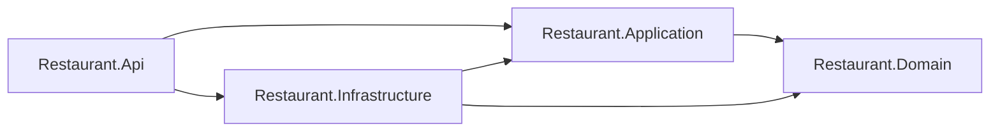

# RestaurantApi

[](https://github.com/Darlin04/RestaurantApi/actions/workflows/ci.yml)

## Descripción y problema de negocio

API REST para que un restaurante controle sus mesas, su menú y las órdenes que toman los meseros.

La versión anterior tenía la lógica en controladores y servicios, el subtotal lo enviaba el cliente y cualquier usuario podía registrarse como administrador. Esta versión corrige eso con reglas en el dominio:

- El subtotal lo calcula el sistema.
- Una mesa solo puede tener una orden activa.
- Las transiciones de estado de mesas y órdenes las controla el agregado.
- Solo un Admin crea usuarios.

## Stack

- .NET 10 con Minimal APIs, JWT y OpenAPI + Scalar.
- PostgreSQL 17 con Entity Framework Core 10 (Npgsql, nombres `snake_case`, esquemas `restaurant` e `identity`).
- ASP.NET Core Identity para usuarios y roles.
- FluentValidation para la validación de requests.
- Pruebas con NUnit, Shouldly, Moq y Testcontainers.
- Clean Architecture con DDD táctico, sin MediatR.

## Arquitectura



Los diagramas de estados, el modelo de datos y la secuencia de "abrir orden" están en [docs/architecture.md](docs/architecture.md).

## Estructura de carpetas

```
RestaurantApi/
├─ src/
│  ├─ Restaurant.Domain/          agregados, value objects y errores de negocio
│  ├─ Restaurant.Application/     casos de uso (command/query handlers) y validators
│  ├─ Restaurant.Infrastructure/  EF Core, repositorios, Identity y JWT
│  └─ Restaurant.Api/             endpoints, manejo de errores y arranque
├─ tests/
│  ├─ Restaurant.Domain.Tests/
│  ├─ Restaurant.Application.Tests/
│  └─ Restaurant.Api.IntegrationTests/   PostgreSQL real con Testcontainers
├─ docs/                          arquitectura
└─ docker-compose.yml · Dockerfile · .env.example
```

## Requisitos

- .NET SDK 10 (el de `global.json`).
- Docker, para la base de datos local y para los tests de integración.
- `dotnet-ef` para generar migraciones: `dotnet tool install --global dotnet-ef`.

## Cómo ejecutar

Copiar la plantilla de variables de Docker y poner valores locales en `.env`:

```bash
cp .env.example .env
```

Levantar solo la base de datos:

```bash
docker compose up -d db
```

Configurar los secretos de desarrollo (una vez por máquina, ver la siguiente sección):

```bash
dotnet user-secrets set "Seed:AdminEmail" "admin@restaurant.local" --project src/Restaurant.Api
```

Aplicar las migraciones:

```bash
dotnet ef database update --project src/Restaurant.Infrastructure --startup-project src/Restaurant.Api
```

Ejecutar la API:

```bash
dotnet run --project src/Restaurant.Api
```

Comprobar que responde:

```bash
curl http://localhost:5099/health
```

Con Docker completo (base de datos y API en el puerto 8080; con `dotnet run` la API usa el 5099, según `launchSettings.json`):

```bash
docker compose up --build
```

La documentación interactiva está en `/scalar/v1` (solo en `Development`). El flujo completo de punta a punta está en [src/Restaurant.Api/Restaurant.Api.http](src/Restaurant.Api/Restaurant.Api.http).

## Configuración de secretos

Ningún secreto va en el repositorio. En desarrollo se guardan con `dotnet user-secrets` en el proyecto `Restaurant.Api`, con este `UserSecretsId`: `3f2b6c1e-7a4d-4e8b-9c51-2d6f0a8b7e13`.

| Clave | Qué es |
|---|---|
| `ConnectionStrings:Default` | Cadena de conexión a PostgreSQL |
| `Jwt:Key` | Clave de firma JWT, mínimo 64 caracteres |
| `Seed:AdminEmail` | Correo del administrador inicial |
| `Seed:AdminPassword` | Contraseña del administrador inicial (cumple la política de contraseñas) |

Generar la clave JWT:

```bash
openssl rand -base64 64
```

Guardar un secreto (reemplazar los valores entre `<>`):

```bash
dotnet user-secrets set "ConnectionStrings:Default" "Host=localhost;Port=5432;Database=restaurant;Username=restaurant_app;Password=<POSTGRES_PASSWORD de tu .env>" --project src/Restaurant.Api
```

Si falta `ConnectionStrings:Default`, la API no arranca y muestra el motivo. Lo mismo pasa con la clave JWT y con los valores `Seed:*`.

## Tabla de endpoints

Todos los endpoints van bajo `/api/v1`, salvo `/health`. Si no se indica lo contrario, requieren token.

| Método y ruta | Política | Descripción |
|---|---|---|
| `GET /health` | anónimo | Estado de la API y la base de datos |
| `POST /auth/login` | anónimo, 5 por minuto por IP | Inicia sesión y devuelve un JWT |
| `GET /auth/me` | autenticado | Usuario actual |
| `POST /users` | Admin | Crea un usuario Admin o Waiter |
| `GET /users` | Admin | Lista usuarios, con filtros por rol y estado |
| `GET /users/{id}` | Admin | Consulta un usuario |
| `PATCH /users/{id}/deactivate` | Admin | Desactiva un usuario y corta su acceso |
| `PATCH /users/{id}/activate` | Admin | Reactiva un usuario |
| `POST /ingredients` | Admin | Crea un ingrediente |
| `GET /ingredients` | Staff | Lista ingredientes ordenados por nombre |
| `GET /ingredients/{id}` | Staff | Consulta un ingrediente |
| `PUT /ingredients/{id}` | Admin | Renombra un ingrediente |
| `DELETE /ingredients/{id}` | Admin | Elimina un ingrediente que no está en uso |
| `POST /dishes` | Admin | Crea un plato con sus ingredientes |
| `GET /dishes` | Staff | Lista platos, con filtros por categoría y estado |
| `GET /dishes/{id}` | Staff | Consulta un plato con sus ingredientes |
| `PUT /dishes/{id}` | Admin | Actualiza un plato activo |
| `PATCH /dishes/{id}/deactivate` | Admin | Desactiva un plato |
| `PATCH /dishes/{id}/activate` | Admin | Activa un plato |
| `POST /tables` | Admin | Crea una mesa |
| `GET /tables` | Staff | Lista mesas, con filtro por estado |
| `GET /tables/{id}` | Staff | Consulta una mesa |
| `PUT /tables/{id}` | Admin | Actualiza capacidad y descripción de una mesa disponible |
| `PATCH /tables/{id}/release` | Staff | Libera una mesa atendida |
| `POST /orders` | Waiter | Abre una orden en una mesa disponible |
| `POST /orders/{id}/items` | Waiter | Agrega un plato a una orden en curso |
| `DELETE /orders/{id}/items/{itemId}` | Waiter | Quita un plato de una orden en curso |
| `PATCH /orders/{id}/complete` | Waiter | Completa una orden y marca su mesa como atendida |
| `GET /orders` | Staff | Lista órdenes paginadas, con filtros por mesa y estado |
| `GET /orders/{id}` | Staff | Consulta una orden con sus items |

Roles: `Admin` y `Waiter`. `Staff` significa cualquiera de los dos.

Los errores de negocio responden un `ProblemDetails` con un campo `code` (por ejemplo `Table.InvalidTransition` o `Dish.DuplicateName`).

## Limitaciones conocidas

- **Sin refresh tokens.** El JWT dura 60 minutos y después hay que iniciar sesión otra vez.
- **Rate limiting por IP.** El límite del login usa la IP directa. Detrás de un proxy inverso hay que configurar `ForwardedHeaders`, y eso no está configurado todavía.
- **Regla de sala.** Cualquier `Waiter` puede agregar, quitar o completar cualquier orden en curso. `WaiterId` solo registra quién la abrió.
- **Tests de integración con Docker.** Necesitan Docker para levantar PostgreSQL con Testcontainers.
- **Sin remoto de GitHub.** El repositorio local no tiene remoto todavía, así que el CI descrito en `.github/` no se ha ejecutado.
