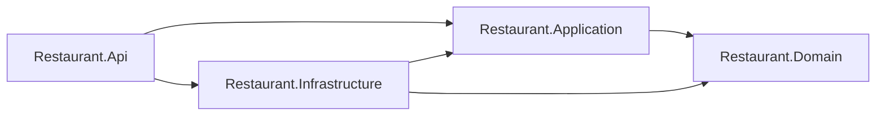
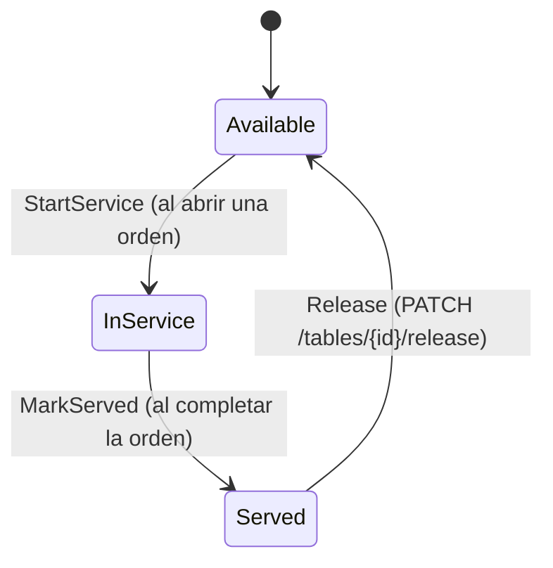
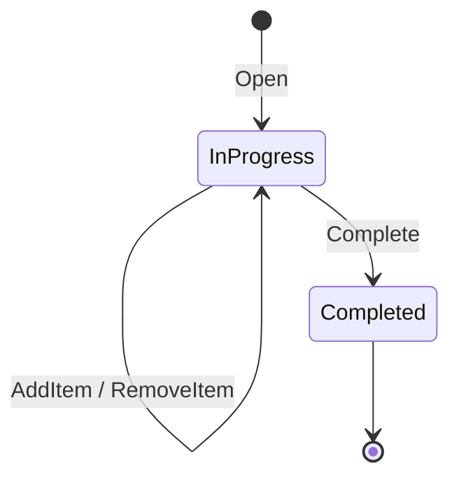
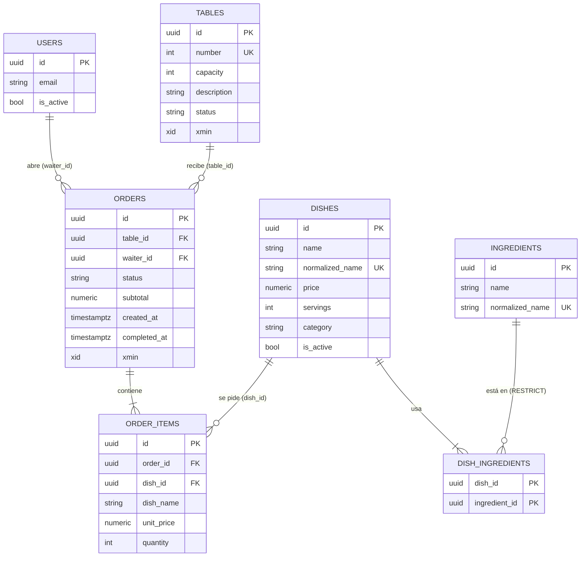
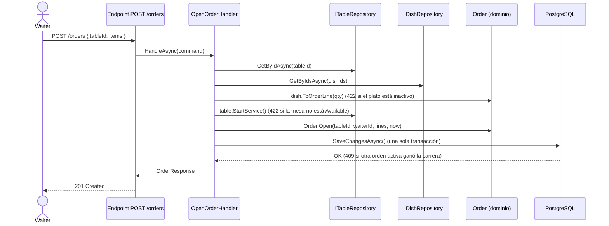

# Arquitectura

## Dependencias entre capas

Las referencias entre proyectos son solo estas: Application → Domain, Infrastructure → Application y Domain, Api → Application e Infrastructure.

## Diagrama de estados de mesa

## Diagrama de estados de orden

## Modelo de datos

Índices que no aparecen en el diagrama: `orders(table_id, status)` y el índice único parcial `orders(table_id) WHERE status = 'InProgress'`, que garantiza una sola orden activa por mesa.

## Secuencia abrir orden

